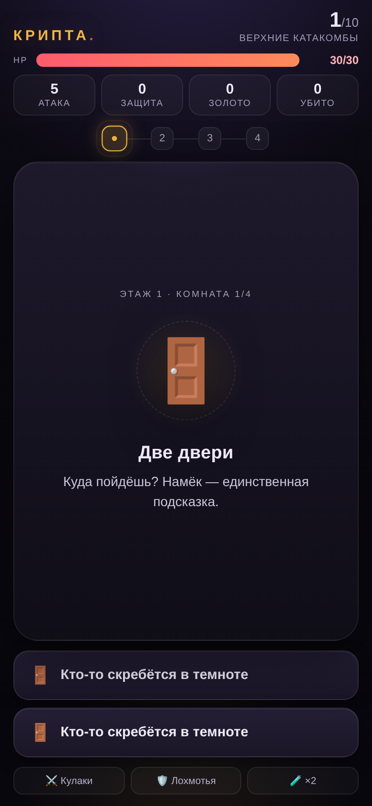
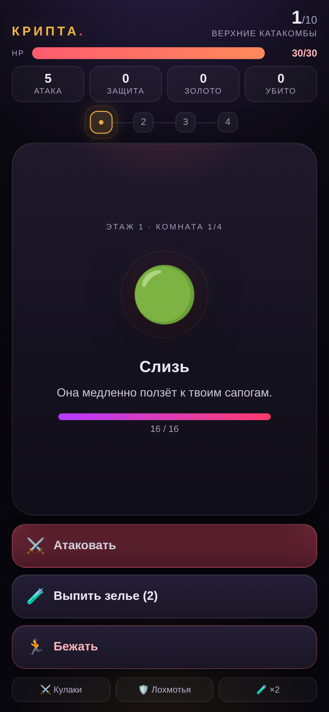
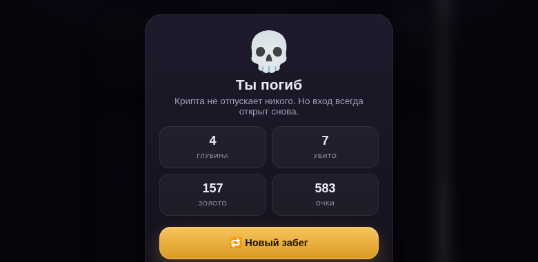

# 🕯 Крипта

Рогалик в Telegram: **10 этажей, две двери на выбор, страж на пятом и один из четырёх боссов внизу**. Одна игра — два интерфейса: кнопки в чате и Mini App с картой, анимациями и инвентарём. Забег общий: начал в чате, открыл приложение — продолжил с того же места.

<p>
  
  
  
</p>

## Что за игра

- Каждый этаж — 4 комнаты, в каждой две двери с туманной подсказкой («Из-за двери слышно дыхание»). Тип комнаты игрок не видит — только намёк. Подсказки двух дверей никогда не повторяются.
- Внутри: монстры, сокровища, ловушки, алтари. У каждого монстра свой характер: одни бьют тяжело, другие травят, лечатся, прикрываются щитом или уходят от удара.
- **Бой по телеграфу.** Монстр заранее показывает, что сделает: обычный удар, тяжёлый замах, яд, лечение или подготовку. Тяжёлый удар почти не пробивает защиту — но если просто бить в ответ, он снимает половину здоровья. Отсюда реальный выбор: атаковать, прикрыться, лечиться или бежать.
- Лут усиливает персонажа: оружие даёт атаку, броня — защиту. Названия кнопок атаки зависят от оружия и меняются от хода к ходу.
- Алтарь даёт выбор: лечение, +2 к атаке или зелье за золото.
- На 5-м этаже — один из трёх стражей (Смотритель катакомб, Гнилой аббат, Мать выводка). На 10-м — один из четырёх финальных боссов со своими фазами и повадками. Победа над финальным боссом закрывает забег.
- **Забег дня** — одинаковый сид для всех, отдельный лидерборд. У кого глубже и больше золота — тот и молодец.

Генерация детерминированная: забег определяется сидом, поэтому «Забег дня» у всех совпадает комната в комнату.

## Быстрый старт

```bash
python -m venv .venv && source .venv/bin/activate
pip install -r requirements.txt
cp .env.example .env          # вписать BOT_TOKEN
python run.py                 # веб + бот в одном процессе
```

Для разработки без бота:

```bash
DEV_MODE=1 python run.py --no-bot
# открыть http://localhost:8000/?dev=1
```

`DEV_MODE=1` отключает проверку подписи Telegram и подставляет пользователя из заголовка `X-Dev-Id`. **В продакшене всегда `DEV_MODE=0`.**

### Mini App и HTTPS

Telegram открывает Mini App только по `https://`. Варианты:

- домен + Caddy (самый простой TLS):
  ```caddy
  crypta.example.com {
      reverse_proxy 127.0.0.1:8000
  }
  ```
- временный туннель для теста: `cloudflared tunnel --url http://localhost:8000` — полученный `https://...trycloudflare.com` вписать в `WEBAPP_URL`.

После этого `WEBAPP_URL=https://crypta.example.com python run.py`. Кнопка меню «Играть» ставится автоматически при старте бота.

## Как устроено

```
run.py          запускает uvicorn и polling в одном процессе
bot.py          хендлеры aiogram: /start /play /top /stats /help + инлайн-кнопки
web.py          FastAPI: Mini App + API
auth.py         проверка initData по HMAC-SHA256
config.py       настройки из .env
game/engine.py  вся игровая логика — чистый Python, без Telegram и HTTP
game/content.py монстры, предметы, подсказки, тексты
game/render.py  текст сообщения для чата и view-модель для Mini App
game/storage.py SQLite: забег хранится как JSON
webapp/         HTML + CSS + JS без фреймворков
scripts/serve.sh     туннель + приложение одной командой (то, что запускает systemd)
scripts/setup_bot.py имя, описания и команды бота через Bot API
scripts/make_avatar.py аватар для бота (Pillow, без внешних файлов)
scripts/simulate.py  прогон тысяч забегов для баланса
deploy/crypta.service юнит systemd
docs/HANDOFF.md      состояние проекта для передачи контекста
tests/          50 тестов: движок, API, подпись, хендлеры бота
```

Главная идея — одна точка изменения состояния:

```python
events = engine.apply(state, "door:0")   # бот и Mini App вызывают одно и то же
```

Бот рисует `render.chat_text(state)`, приложение — `render.view(state)`. Логика не дублируется, поэтому режимы не расходятся.

## API

| Метод | Путь | Что делает |
|---|---|---|
| GET | `/api/state` | текущий забег (создаёт, если его нет) |
| POST | `/api/action` | `{"action": "door:0"}` — сделать ход |
| POST | `/api/new` | `{"daily": false}` — новый забег |
| GET | `/api/top?daily=1` | таблица лидеров |
| GET | `/api/me` | статистика игрока |

Авторизация: заголовок `X-Init-Data` с `window.Telegram.WebApp.initData`. Сервер проверяет подпись токеном бота и срок жизни (24 часа). Типы дверей клиенту не отдаются — иначе их видно в сетевой панели.

## Тесты и баланс

```bash
pytest -q                    # 50 тестов
python scripts/simulate.py 3000
```

Баланс на 2000 забегов:

| политика | побед | медиана глубины |
|---|---|---|
| случайные клики | 0.1% | 5 |
| «всегда атаковать» | 0.0% | 4 |
| осторожная (зелья по HP) | 7.1% | 7 |
| «умная» (зелья + алтарь) | 7.5% | 7 |
| тактическая (читает телеграф и прикрывается от тяжёлых) | 20.8% | 8 |

То есть кликать наугад и просто держать «Атаковать» бесполезно: так игру не пройти. Разница между 7% и 21% — это и есть чтение телеграфа и защита. Смерти размазаны по этажам 4–10, страж на пятом — главный фильтр.

## Переменные окружения

| Переменная | По умолчанию | Зачем |
|---|---|---|
| `BOT_TOKEN` | — | токен от @BotFather |
| `WEBAPP_URL` | — | публичный HTTPS-адрес Mini App |
| `DB_PATH` | `crypta.db` | файл SQLite |
| `HOST` / `PORT` | `0.0.0.0` / `8000` | адрес веб-сервера |
| `DEV_MODE` | `0` | `1` — вход без Telegram (только для разработки) |

## Деплой

**Docker** (нужен свой домен для HTTPS):

```bash
docker compose up -d --build
```

`crypta.db` лежит в томе `crypta-data`, переживает перезапуск. TLS — Caddy/nginx перед контейнером.

**Без домена — systemd + quick tunnel** (так запущено на текущей машине):

```bash
install -m 644 deploy/crypta.service /etc/systemd/system/
systemctl daemon-reload && systemctl enable --now crypta
journalctl -u crypta -f
```

`scripts/serve.sh` поднимает `cloudflared`, вытаскивает `https://*.trycloudflare.com`
и передаёт адрес в `WEBAPP_URL`. Адрес временный: при перезапуске меняется,
бот сам подставит новый в кнопку меню. Для постоянного адреса нужен домен.

Профиль бота (имя, описания, команды, аватар):

```bash
python scripts/setup_bot.py
python scripts/make_avatar.py docs/avatar.png
```

## Что можно добавить дальше

- Магазин между этажами (золото уже есть, тратить почти некуда).
- Ежедневные задания и серии забегов.
- PvP-дуэли на одном сиде: кто глубже за 24 часа.
- Классы персонажа (воин/вор/маг) с разными действиями в бою.
